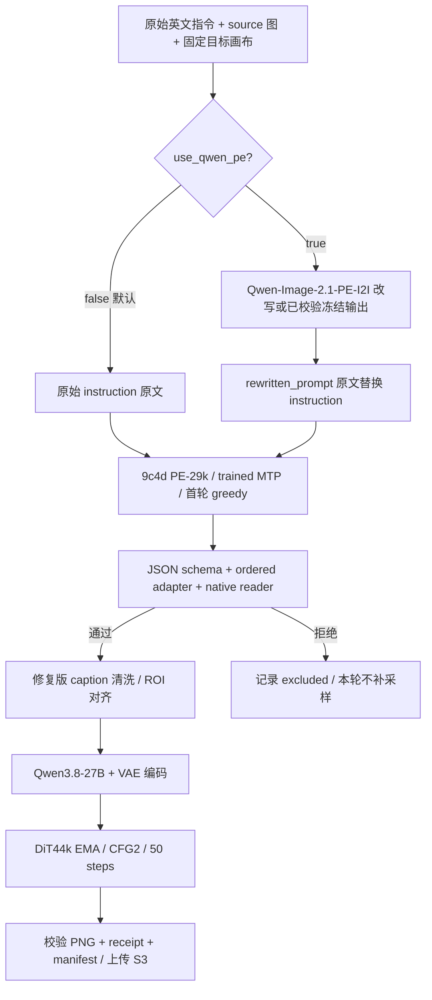

# PE-29k + 可选 Qwen-PE → JSON caption → 修复版 DiT44k 编辑生图（v2）

更新：2026-10-09。面向需要复用本轮 PixelCraftBench 推理流程的同事。

**Qwen-PE 默认关闭，可通过 `--use-qwen-pe` 开启。关闭时，用户原始 instruction 原文送入 PE-29k；开启时，Qwen-PE 的 `rewritten_prompt` 原文替换 instruction，再送入 PE-29k。** 两条分支使用同一个训练 run `9c4d7a32e190` / checkpoint-29000、`dit44k-pe-order-clean-jfd-v1` 原生准备及 DiT step 44000 EMA / CFG2 / 50 steps。

**所有 checkpoint 的来源配置均为 S3 URI**，统一位于 `workflow/checkpoint-sources.json`；配置校验拒绝本地路径。模型加载所用目录由恢复脚本在当前运行目录下生成，只是 S3 下载缓存，无须访问原提交者的 devbox。`original_instruction` 始终保留，用于评分及审计。

版本关系：v1 保持冻结；本 v2 同时交付更新后的代码、两条分支的回归测试与本文。先在新目录解包，运行一次 `configure_pipeline.py`，再进入 caption / editor。运行开始后禁止在同一目录切换开关。

下述历史 Qwen 开启实验最终发布采用 **PE 首轮 greedy caption**：1,464 条首轮预测，1,427 条通过 schema 和 native reader 校验，37 条排除，生成 1,427 张图。Qwen-PE 自身的改写采样参数不同，见第 5 节。

交接文件根目录：

```text
s3://core-cn-oss.canva.com/usr/grantzhang/pixelcraftbench-v2/handovers/pe29-optional-qwen-dit44k-fixed-20261009-v2/
```

交付物包括 `handover.md`、`workflow-sources.tar.gz`、`package.manifest.json`、`LOCAL_VERIFIED.json`、`S3_SOURCES_VERIFIED.json` 和上传校验回执 `VERIFIED.json`。源码包包含实际使用的训练 prompt、caption runner、修复版原生 runtime、模型锁、输入快照、Qwen-PE 改写代码及最终结果证据；大模型和 Python / Docker 环境通过已有 S3 资产恢复。

**验证范围：** 本次使用完整 1,464 条冻结样本验证开关两条分支，经过真实 PE `normalize_record`；验证原文透传、改写替换、source / canvas 保持一致、异常改写拒绝、模式切换拒绝和 S3-only 来源校验。执行静态语法检查及源码包逐文件校验。没有重新运行 GPU 推理、下载完整模型或恢复完整环境；下文 1,427 张图及 GSB 均为历史 Qwen 开启实验结果，不能作为本次关闭分支的生图验收。新机器仍须完成环境 import 和 canary。

## 1. 流程与复用入口



| 需求 | 从哪里开始 |
|---|---|
| 直接使用本轮 JSON caption 和图片 | 第 2 节，下载最终结果 |
| 直接使用用户原始指令 | 第 6.2 节 `--no-use-qwen-pe`（默认），跳过 Stage A |
| 使用 Qwen 改写后重新跑 PE 和 DiT | 第 6.2 节 `--use-qwen-pe`，默认使用冻结改写，或按第 5 节重跑 |
| 只重跑 DiT | 使用冻结 `greedy-only/caption/predictions.jsonl`；重新执行第 7–9 节的原生准备和生图 |
| 重新运行 Qwen-PE 改写 | 第 5 节；作为新实验重新冻结输入和 provenance |
| 更换题库或模型 | 第 11 节的迁移清单；现有 runner 的题库身份校验需要显式适配 |

## 2. 已完成结果：直接读取

为避免混淆，本文件用以下两个前缀：

```bash
export PE29_BASE=s3://core-cn-oss.canva.com/usr/grantzhang/pixelcraftbench-v2/evaluations/9c4d29-qwenrewrite-dit44k-fixed-20261007
export PE29_FINAL="${PE29_BASE}/greedy-only"
```

| 对象 | S3 路径（相对于 `PE29_FINAL/`） | 数量 / 含义 |
|---|---|---|
| 首轮 JSON caption 全集 | `caption/predictions.jsonl` | 1,464 条，含未通过项 |
| 可用于本轮 DiT 的 JSON caption | `caption/admitted.jsonl` | **1,427 条** |
| 排除项 | `caption/excluded.jsonl` | 37 条，含 reader / schema 拒绝原因 |
| 编辑结果图 | `editor/images/cfg2/` | **1,427 张 PNG** |
| 样本与图片对应表 | `editor/score-index.jsonl` | **推荐消费入口**，保留样本身份与 provenance |
| 图片校验清单 | `editor/images.manifest.jsonl` | URI、大小、SHA256 |
| 每图推理回执 | `editor/receipts/<request_id>.json` | seed、checkpoint、bundle、数值验证等 |
| 实际送入 encoder 的提示词 | `editor/native-inputs/<request_id>/model-prompts.json` | positive / weak 文本 |
| 完成回执 | `COMPLETE.json`、`unit-proofs.json` | 25 个工作分区的发布证据 |
| GSB | `gsb-vs-qwen21/` | scores、summary、protocol、VERIFIED |

完整核心路径：

```text
# PE-29k + Qwen-PE：原始首轮预测
s3://core-cn-oss.canva.com/usr/grantzhang/pixelcraftbench-v2/evaluations/9c4d29-qwenrewrite-dit44k-fixed-20261007/greedy-only/caption/predictions.jsonl

# 已通过原生编辑校验的 caption
s3://core-cn-oss.canva.com/usr/grantzhang/pixelcraftbench-v2/evaluations/9c4d29-qwenrewrite-dit44k-fixed-20261007/greedy-only/caption/admitted.jsonl

# 修复版 DiT44k 图片
s3://core-cn-oss.canva.com/usr/grantzhang/pixelcraftbench-v2/evaluations/9c4d29-qwenrewrite-dit44k-fixed-20261007/greedy-only/editor/images/cfg2/

# 样本对应表
s3://core-cn-oss.canva.com/usr/grantzhang/pixelcraftbench-v2/evaluations/9c4d29-qwenrewrite-dit44k-fixed-20261007/greedy-only/editor/score-index.jsonl
```

读取示例（本机先配置自己的 S3 profile）：

```bash
export AWS_PROFILE=prod_core-cn-readwrite
mkdir -p pe29-results
aws s3 cp "${PE29_FINAL}/COMPLETE.json" pe29-results/COMPLETE.json
aws s3 cp "${PE29_FINAL}/caption/admitted.jsonl" pe29-results/admitted.jsonl
aws s3 cp "${PE29_FINAL}/editor/score-index.jsonl" pe29-results/score-index.jsonl
aws s3 sync "${PE29_FINAL}/editor/images/cfg2/" pe29-results/images/cfg2/
```

完成时间为 **2026-10-07 14:49:23 UTC**。历史结果的最终数量和策略以 **`greedy-only/COMPLETE.json`** 为准。v2 的 campaign 和输入锁由配置命令重新生成；`worker.py` 仅保留首轮推理及 admission 函数，历史重试调度入口保存在 v1 归档中。

## 3. 模型身份与“修复后 DiT44k”的含义

### 3.1 三个模型阶段

| 阶段 | 固定身份 |
|---|---|
| 指令改写 | `Qwen/Qwen-Image-2.1-PE-I2I`，revision `72927bc08afc99b7888ceb7d7d51a12db3700bbd` |
| JSON caption | `canva-core-cn/design-layout-megatron-swift/9c4d7a32e190`，**checkpoint-29000** |
| 编辑生成 | `edit1k-ocr93-r38k-15n-1004-0156`，**step=44000，EMA** |

[PE 训练记录](https://forge.coreweave.com/wandb/canva-core-cn/design-layout-megatron-swift/runs/9c4d7a32e190)。固定步骤，不读取 latest。

```text
# PE 原始 MCore checkpoint
s3://core-cn-oss.canva.com/usr/grantzhang/design-layout-megatron-swift/runs/iev6-ocrv5-c17k-h200192-fa3/20261004-9c4d7a32e190/mcore/checkpoint-29000/

# 已导出的 trained-MTP HF 模型；下载后核对 local_export_manifest.json
s3://core-cn-oss.canva.com/usr/grantzhang/pixelcraftbench-v2/evaluations/9c4d29-qwenrewrite-dit44k-fixed-20261007/assets/model-29000/
# 发布完成证明（恢复时先读取）
s3://core-cn-oss.canva.com/usr/grantzhang/pixelcraftbench-v2/evaluations/9c4d29-qwenrewrite-dit44k-fixed-20261007/assets/MODEL_READY.json

# DiT 原始分布式 checkpoint
s3://core-cn-training.canva.com/pixelcraft/usr/tayo/runs/edit1k-ocr93-r38k-15n-1004-0156/checkpoints/step=44000.ckpt/

# 已提取的 EMA DCP；保留原序列化 tensor 字节，无 cast / 重算
s3://core-cn-oss.canva.com/usr/grantzhang/pixelcraftbench-v2/evaluations/pe4-dit44k-20261006/shared/checkpoint-ema-compact/

# DiT 文本 encoder / VAE
s3://core-cn-oss.canva.com/checkpoints/qwen/Qwen3.8-27B/
s3://core-cn-oss.canva.com/checkpoints/flux2/FLUX.2-klein-4B-vae/
```

PE HF export 含 738 个 tensor，15 个 MTP tensor 均经过训练。HF initializer 不能直接充当 PE-29k 模型。精确模型清单由 `workflow/model-export-manifest.reference.json` 的 S3 URI 与 SHA256 锁定；PE 模型锁为 `workflow/caption-model.lock.json`。历史 export manifest 在 S3 原样保留其哈希，不作为本地模型来源配置。

### 3.2 统一 checkpoint 配置

`workflow/checkpoint-sources.json` 是唯一模型来源表，所有值必须为 `s3://bucket/key/`。包含 Qwen-PE、PE29 原始 MCore、PE29 trained HF、PE initializer、DiT44 原始 checkpoint、DiT44 EMA、文本 encoder、VAE。S3 来源与已冻结模型身份不符时停止；更换模型必须同时更新对应模型锁和校验。

```text
# Qwen-PE checkpoint 镜像（仅重跑 Stage A 时下载）
s3://core-cn-oss.canva.com/usr/grantzhang/pixelcraftbench-v2/evaluations/qwen21-pe-i2i-edit-eagle64-20260928/models/pe/files/
# PE initializer 仅用于训练/export lineage；推理使用上面的 PE29 trained HF
s3://core-cn-oss.canva.com/usr/joeyzhang/design-layout-megatron-swift/models/qwen35-4b-base-hf-mtp-851bf6e-v1/
```

`stage_models.py` 恢复 PE29/Qwen 并逐文件核验 SHA；`stage_checkpoint.py` 恢复 EMA；`stage_runtime.py` 恢复 encoder/VAE。`/checkpoint`、`/models` 和 `assets/` 中模型目录是容器运行时缓存/别名，不能作为来源配置。无需 devbox 上预先存在的 checkpoint。

### 3.3 修复的是推理中的 caption 准备

版本：**`dit44k-pe-order-clean-jfd-v1`**。沿用上述 DiT44k checkpoint，修复内容由以下文件实现：

| 文件（相对于 `workflow/runtime/`） | 作用 |
|---|---|
| `tayo_eval/adapt_pe_to_native.py` | 按 PE 训练 schema 恢复字典字段顺序；保留列表语义顺序；xyxy_1000 → yxyx_1000；检查 edit / remove 对应关系 |
| `training_reader/clean_caption.py` | 使用训练 caption processor 执行确定性清洗；关闭随机字段、palette、bbox 删除；保留几何信息供 reader 抽取 |
| `training_reader/craft_v1_edit_mds.py` | 在 tokenization / ROI span 对齐之前完成文本规范化 |
| `tayo_protocol/code/prepare_inputs.py` | 记录最终提示词、native batch、prep version 等证据 |
| `pcb_edit/run_single_protocol.py` | 拒绝旧 prep version，冻结 checkpoint / config / native manifest，完整验图 |

根字段顺序为 `normalized_edit_instruction` → `high_level_description` → `style_description` → `elements`。**不要对 caption 使用 `json.dumps(..., sort_keys=True)`。** 列表（layout / actions / palette / source endpoints）不能排序。

每条 native manifest 必须含 `caption_preparation_version=dit44k-pe-order-clean-jfd-v1`。修改 caption 清洗、顺序或 adapter 后，必须新建 work，重新 admission、encode、infer；原来的 bundle 与图片不能沿用。逐文件修复 SHA 在 `workflow/ADAPTATION_VERIFIED.json`。

## 4. H100 环境、权限和恢复

### 4.1 运行条件

- 使用自己已授权的 UTP GPU 作业。历史执行为 25 个 8-H100 工作分区，共 200 H100；数量只是当时分配，当前复用可选择自己的分区数。
- Gcore 所在集群为 `general-aws-euc1-prod-hc0`。新申请按团队 Arnold / UTP 流程，填写自己的 submitter、`project-id`、core-cn 队列和所需 priority。只将属于本作业的 GPU 分配给下列进程。
- 下述命令在专用 Pod 内执行，每节点一个工作流，不能让两个任务同时改 `/app`、`/work`、`/opt/runtime` 等全局别名。
- Pod 内脚本使用 **`core-cn-s3-readwrite` profile 名**；它必须由团队认可的凭证刷新机制提供有效 S3 权限。角色名称不是 S3 权限的证明，先实际读取输入/模型、向自己的结果前缀写入一个小对象并回读。
- 本轮 workload 可通过 `service.core-cn-model-trainer` 获得目标桶读写；不要直接把人用 `core-cn-readwrite` SSO 身份当作 Gcore Pod 的 WebIdentity role。交接包不包含任何凭证。
- Gcore 跨区 S3 下载可能慢，先缓存模型和图片。`/mnt/ephemeral` 是节点缓存；最终结果持久化到 S3。
- Python 3.12、Linux x86_64、兼容 H100 的 NVIDIA driver、AWS CLI、boto3。为归档解压、模型和中间产物预留足够磁盘；实践上可先预留 300 GB，再根据分区大小与缓存检查 `df -h`。

Caption 和编辑使用不同环境：

| 环境 | 固定内容 |
|---|---|
| PE caption 快照 | Python 3.12.12、torch 2.11.0、vLLM 0.26.0、transformers 5.8.0；完整依赖以环境归档为准 |
| 原生编辑 | torch `2.13.0a0+8145d630e8.nv26.06`、transformers 5.8.0、CUDA 13.3；通过独立 `editor_env.sh` + `/opt/runtime/bin/python -S` |
| 原生镜像协议身份 | `699983977898.dkr.ecr.us-east-1.amazonaws.com/ds-core-cn-omra-trainer@sha256:6e6eba1b4309475e8234e38e6eecfea04d039677a63cc96f05f578b89fe81fb2` |
| 恢复用 Docker archive 的 config ID | `baa2ff80885bc029e33cbd11c433da5d14cfd5533ccbb09e9380595f37ef0af4`；由解包器校验 |

运行中使用 H100/SM90 的 CurrentScaling TE、FA4 varlen 适配和 pixel-aspect ROI 修复。不要换用任意 pip 环境或随意移除 attention mask。相同 seed 不构成跨硬件逐像素一致保证。

### 4.2 下载并校验代码包

```bash
export AWS_PROFILE=core-cn-s3-readwrite
export PE29_HANDOVER=s3://core-cn-oss.canva.com/usr/grantzhang/pixelcraftbench-v2/handovers/pe29-optional-qwen-dit44k-fixed-20261009-v2
export PE29_ROOT=/mnt/ephemeral/pe29-reproduction
mkdir -p "$PE29_ROOT"
cd "$PE29_ROOT"
aws s3 cp "${PE29_HANDOVER}/package.manifest.json" package.manifest.json
aws s3 cp "${PE29_HANDOVER}/workflow-sources.tar.gz" workflow-sources.tar.gz
python3 - <<'PY'
import hashlib,json
from pathlib import Path
m=json.loads(Path('package.manifest.json').read_text())
r=next(x for x in m['files'] if x['key']=='workflow-sources.tar.gz')
p=Path(r['key'])
assert p.stat().st_size==r['bytes']
with p.open('rb') as f: assert hashlib.file_digest(f,'sha256').hexdigest()==r['sha256']
PY
tar -xzf workflow-sources.tar.gz
python3 verify_package.py
```

恢复后的主要目录：

```text
workflow/code/              PE-29k runner、环境绑定、历史 worker
workflow/runtime/           修复版 DiT44k 完整原生推理代码
workflow/native-binaries/   冻结 Python 3.12 native extension
workflow/inputs.jsonl       configure_pipeline.py 按开关生成的 1464 条 PE 输入
workflow/inputs/            原始输入、Qwen 改写输出和模型锁
assets/code/pe_repo/        PE runner 所依赖的 dlms / scripts
assets/code/prompt_runtime/ 9c4d 的训练 prompt
qwen_rewrite/               Qwen-PE 改写代码（由 run_qwen_rewrite.py 绑定当前运行）
published/                  已发布结果索引、完成与评分证据
configure_pipeline.py      选择 instruction 分支并重新冻结输入/配置/审计
workflow/checkpoint-sources.json  全部模型的 S3 来源
stage_models.py             从 S3 下载和校验 PE29 / Qwen-PE
run_qwen_rewrite.py         可选 Qwen-PE 推理入口
restore_caption_env.py      仅恢复 caption Python 环境，不启动推理
files.manifest.json         交接源码包的逐文件校验值
```

### 4.3 下载 caption 环境、PE 权重和编辑资产

```bash
python3 "$PE29_ROOT/restore_caption_env.py" \
  --assets "$PE29_ROOT/assets" --profile core-cn-s3-readwrite
export PE29_PY="$PE29_ROOT/assets/env/caption/bin/python"

python3 "$PE29_ROOT/stage_models.py" --model pe29_hf --profile core-cn-s3-readwrite

python3 "$PE29_ROOT/workflow/code/stage_runtime.py"
python3 "$PE29_ROOT/workflow/code/stage_checkpoint.py"
```

`stage_runtime.py` 按归档 SHA 解包到 `/mnt/ephemeral/pcb-v2-9c4d-editor-runtime/image-rootfs`，下载并逐文件验证 encoder / VAE；`stage_checkpoint.py` 恢复经过字节保真验证的 EMA DCP 到当前解包目录派生的 `assets/checkpoint-ema-compact` 缓存。这些是容器内兼容路径，和提交者用户名无关。

环境归档位于 `.../handovers/18k-caption-48k-ema-gsb-20261001-v1/archives/`，这里只复用运行环境；caption 权重和代码仍由本交接锁定。两份大归档的 URI / bytes / SHA 见 `shared-assets.json`。PE HF 模型恢复依赖 `MODEL_READY.json` 与逐文件哈希；如果缺少完成标记，停止并核查发布状态，不能把部分下载目录当作完整模型。

## 5. Stage A：可选 Qwen-PE 改写

### 5.1 默认跳过；开启时可复用冻结输出

- 不启用 Qwen-PE：直接进入第 6.2 节。不会读取 Qwen 预测文件、下载 Qwen 模型或调用 Qwen engine。
- 启用 Qwen-PE：第 6.2 节加 `--use-qwen-pe`。默认复用随包冻结的 `workflow/inputs/qwen-pe-predictions.jsonl`，按原始样本身份校验并提取 `rewritten_prompt`。
- 需要重新改写：执行本节剩余内容，然后在第 6.2 节显式指定新的预测 JSONL 与 S3 URI。Qwen 失败、空输出、截断、重复、缺失或身份错配均停止，不回退原指令。

冻结输出与模型清单：

```text
s3://core-cn-oss.canva.com/usr/grantzhang/pixelcraftbench-v2/evaluations/9c4d29-qwenrewrite-dit44k-fixed-20261007/inputs/qwen-pe-predictions.jsonl
s3://core-cn-oss.canva.com/usr/grantzhang/pixelcraftbench-v2/evaluations/9c4d29-qwenrewrite-dit44k-fixed-20261007/inputs/qwen-run.lock.json
s3://core-cn-oss.canva.com/usr/grantzhang/pixelcraftbench-v2/evaluations/qwen21-pe-i2i-edit-eagle64-20260928/models/pe/manifest.json
```

### 5.2 重新运行时遵守的调用协议

实现入口为 `qwen_rewrite/pe_worker.py`、`official/pe_core.py`，采样锁在 `run.lock.json`。

| 参数 | 值 |
|---|---|
| engine / dtype / TP | vLLM 0.26.0 / bf16 / 1 |
| max_model_len / max_new_tokens | 32768 / 24000 |
| max_num_seqs / GPU memory | 8 / 0.80 |
| enforce_eager / prefix caching | true / false |
| thinking | true |
| temperature / top_p / top_k | 1.0 / 0.95 / 20 |
| min_p / presence_penalty | 0 / 0 |
| seed | 42 + 原始 input_index |
| malformed / length 重试 | 最多 3 次尝试；重试 seed 加 `1,000,000 × attempt` |
| source 最大面积 | 1,048,576 pixels，LANCZOS 等比缩放 |

使用模型自带 `system_prompt.txt` 和官方消息结构。用户消息为原始英文 instruction，追加：

```text
Output canvas requirement: width=<W> px, height=<H> px (width × height). Use this output canvas when rewriting the edit instruction.
```

`W,H` 是已校验 GPT Image 2.5 target PNG 的原始宽高。解析使用 `split_thinking()` 和 `parse_answer(..., PROFILES['edit'])`；本轮禁用静默 JSON repair。保留 `raw_text`、attempts、finish_reason、模型 revision、system prompt SHA、`rewritten_prompt`、`wh_ratio`、`ratio_follow`。

`run_qwen_rewrite.py` 将当前运行目录、S3 发布前缀和模型缓存显式绑定给 `pe_worker.py`。保留 64 个逻辑 rank；每张已分配 GPU 顺序处理属于它的 rank。只有重跑改写才需要下载 Qwen 权重：

```bash
export PE29_NEW_S3=s3://core-cn-oss.canva.com/usr/YOUR_NAME/pixelcraftbench-v2/evaluations/YOUR_UNIQUE_PE29_RUN
python3 "$PE29_ROOT/stage_models.py" --model qwen_pe --profile core-cn-s3-readwrite
# 单 rank 示例；设置已分配的 GPU，完成全部 0–63 逻辑 rank。
CUDA_VISIBLE_DEVICES=0 "$PE29_PY" "$PE29_ROOT/run_qwen_rewrite.py" \
  --rank 0 --output-s3 "$PE29_NEW_S3" --profile core-cn-s3-readwrite
```

多节点时，各节点的结果会写到同一新 S3 前缀的 `qwen-rewrite/results/pe/`。完成全部 rank 后，在一个节点收集并冻结：

```bash
aws s3 sync "${PE29_NEW_S3}/qwen-rewrite/results/pe/" "$PE29_ROOT/qwen-collected/"
python3 - <<'PY'
import json,os
from pathlib import Path
root=Path(os.environ['PE29_ROOT'])
rows=[json.loads(p.read_text()) for p in (root/'qwen-collected').glob('*.json')]
rows.sort(key=lambda r:r['input_index'])
assert len(rows)==1464 and len({r['input_index'] for r in rows})==1464
(root/'new-qwen-predictions.jsonl').write_text(''.join(json.dumps(r,ensure_ascii=False,sort_keys=True,separators=(',',':'))+'\n' for r in rows))
PY
aws s3 cp "$PE29_ROOT/new-qwen-predictions.jsonl" "${PE29_NEW_S3}/qwen-rewrite/predictions.jsonl"
# 后续 configure_pipeline.py 还会完整校验样本、原始 instruction、source、canvas、模型和最终 attempt。
```

### 5.3 两种模式的 PE 输入契约

| 字段 | Qwen 关闭（默认） | Qwen 开启 |
|---|---|---|
| `instruction` | 用户原始 instruction 原文 | `rewritten_prompt` 原文替换 |
| `original_instruction` | 用户原始 instruction | 用户原始 instruction |
| `selection.instruction_policy` | `original_user_instruction_verbatim` | `qwen_image_2_1_pe_i2i_rewritten_prompt_verbatim` |
| `selection.original_instruction_en` / SHA | 必须一致 | 必须一致 |
| `selection.rewritten_instruction_sha256` | 不存在 | 改写文本 SHA |
| Qwen 预测 URI / SHA / record SHA / revision | 不存在 | 必须绑定已冻结输出与模型 |
| sample_id / input_index / source / canvas | 保持原值 | 保持原值 |

不会将原 instruction 与改写拼接。`wh_ratio` / `ratio_follow` 不改变固定画布。目标图像素不输入 PE 或 DiT；native reader 使用黑色占位图。`configure_pipeline.py` 会同步更新 campaign、caption-source-contract、输入 SHA 和 `INPUT_VERIFIED.json`，caption normalizer 根据已选模式校验，不再硬编码某一份 Qwen 预测 SHA。

## 6. Stage B：PE-29k 首轮 JSON caption

### 6.1 参数与 prompt

训练 prompt 来自 `assets/code/prompt_runtime/migration/prompt_iev6_ordered.py`。本轮 9c4d 训练使用非思考 assistant prefix，runner 明确恢复 `<think>\n\n</think>\n\n`。不要替换成旧 34cf 的 prompt/template。

| 参数 | 值 |
|---|---|
| temperature / top_p / seed | **0 / 1 / 42**，`deterministic_greedy_v1` |
| trained MTP | `--num-speculative-tokens 1` |
| attention | FLASHINFER |
| max_model_len / max_new_tokens | 32768 / 27000 |
| max_pixels | 2,359,296 |
| batch_size / request_window | 4 / 16 |
| GPU memory utilization | 0.90 |
| per-GPU concurrency | 一个 vLLM engine；独立 cache 和短 TMPDIR |

禁用继承的 `PE_RETRY_*` 和 `PE_DISABLE_MTP` 环境变量。输入 source 缓存逐张按 bytes、SHA、尺寸核对。JSON 解析成功还需要通过 schema 和 native reader。

### 6.2 初始化自己的工作分区

在每台 8-H100 节点分别设置 `PE29_NODE_INDEX`；`PE29_NODE_COUNT` 在所有节点一致。先使用独立 canary 目录执行少量样本，验收后再运行完整分区。每台节点的 ROOT 都应是新目录。

```bash
export PE29_NODE_INDEX=0
export PE29_NODE_COUNT=8
export PE29_NEW_S3=s3://core-cn-oss.canva.com/usr/YOUR_NAME/pixelcraftbench-v2/evaluations/YOUR_UNIQUE_PE29_RUN

# 默认关闭：用户原始 instruction 直接进入 PE29。
python3 "$PE29_ROOT/configure_pipeline.py" \
  --no-use-qwen-pe --node-count "$PE29_NODE_COUNT" --output-s3 "$PE29_NEW_S3"
```

如需启用 Qwen，使用下面命令**替代**上面的配置命令。每个节点必须使用同一模式与预测快照：

```bash
# 开启并复用已冻结的 Qwen 改写。
python3 "$PE29_ROOT/configure_pipeline.py" \
  --use-qwen-pe --node-count "$PE29_NODE_COUNT" --output-s3 "$PE29_NEW_S3"

# 或开启并使用第 5 节新生成、已上传的改写。
# 多节点先将同一份 predictions.jsonl 下载到各节点。
python3 "$PE29_ROOT/configure_pipeline.py" \
  --use-qwen-pe --node-count "$PE29_NODE_COUNT" --output-s3 "$PE29_NEW_S3" \
  --qwen-predictions "$PE29_ROOT/new-qwen-predictions.jsonl" \
  --qwen-predictions-uri "${PE29_NEW_S3}/qwen-rewrite/predictions.jsonl"
```

三种配置命令只选择一种。关闭模式不允许附带 Qwen 参数。输入 instruction 保留空白与换行，不做 strip、拼接或附加 Qwen 的宽高提示。

上一步只初始化一次。继续执行 source 下载、训练配置恢复和 runtime 绑定：

```bash
cd "$PE29_ROOT/workflow"
"$PE29_PY" - <<'PY'
import os,sys
from pathlib import Path
sys.path.insert(0,str(Path.cwd()/'code'))
import common as w
import torch
i=int(os.environ['PE29_NODE_INDEX']);n=int(os.environ['PE29_NODE_COUNT'])
selected=w.rows(w.ROOT/'inputs.jsonl')[i::n]
assert selected
assert w.sha(w.ROOT/'inputs.jsonl')==w.CFG['input_sha256']
work=w.ROOT/'work';control=w.ROOT/'control'
work.mkdir();(work/'logs').mkdir();(control/'inputs').mkdir(parents=True)
(control/'inputs/all.jsonl').symlink_to(w.ROOT/'inputs.jsonl')
meta=torch.load(w.CHECKPOINT/'meta.pt',map_location='cpu',weights_only=False)
assert meta['global_step']==44000
w.save(work/'training.json',meta['mariana_resume_contract']['effective_config'])
w.bind(work,control)
w.prepare_sources(selected)
w.save(w.ROOT/'partition.json',dict(index=i,count=n,input_indices=[r['input_index'] for r in selected]))
print('PARTITION_READY',len(selected))
PY
```

`bind()` 会安装第 3.3 节修复 overlay，构建物理 `/app`，绑定 `/work`、`/inputs`、`/checkpoint`、`/models`，并过滤会冲突的 host flash-attn / `.pth`。不能只复制 runner 而忽略这些依赖。

### 6.3 只调用首轮推理函数

以下调用复用实际 `worker.infer()`；v2 不提供历史带重试的 main 入口。它按 8 张 GPU 切片，一条样本只处理一次。

```bash
"$PE29_PY" - <<'PY'
import os,sys
from pathlib import Path
for key in list(os.environ):
 if key.startswith('PE_RETRY_') or key=='PE_DISABLE_MTP': del os.environ[key]
sys.path.insert(0,str(Path.cwd()/'code'))
import common as w
import worker
i=int(os.environ['PE29_NODE_INDEX']);n=int(os.environ['PE29_NODE_COUNT'])
selected=w.rows(w.ROOT/'inputs.jsonl')[i::n]
pred=worker.infer([selected[g::8] for g in range(8)],'primary')
for r in w.rows(pred):
 assert r['sampling']['temperature']==0 and r['sampling']['top_p']==1
 assert r['sampling']['seed']==42 and 'native_retry_provenance' not in r
print('PRIMARY_CAPTIONS',pred)
PY
```

实际完整 CLI 由 `code/caption_support.py::make_command()` 生成，包含输入文件 SHA、expected-count、模型 manifest SHA、checkpoint SHA。结果路径为 `workflow/caption/primary/predictions.jsonl`，每 GPU 的 summary / log 在 `caption/primary/gpu-*/`。

只重跑历史 Qwen 实验的 DiT 时，必须配置 `--use-qwen-pe` 并使用其冻结改写；可以从 `PE29_FINAL/caption/predictions.jsonl` 下载已发布预测，再按本节点 input_index 集合选取，保留记录内容和顺序，写入相同 primary 路径，跳过本节模型调用。精确复用已发布 caption 比重新采样更适合只研究 DiT 变化。

## 7. Stage C：原生 admission 与修复后的编码输入

调用完整 reader 校验，保留失败样本和原因：

```bash
"$PE29_PY" - <<'PY'
import sys,shutil
from pathlib import Path
sys.path.insert(0,str(Path.cwd()/'code'))
import common as w
import worker
pred=w.ROOT/'caption/primary/predictions.jsonl'
admission,audit=worker.native_check(pred,'primary')
manifest=w.rows(admission/'manifest.jsonl')
accepted={r['ordinal'] for r in manifest if r['status']=='ready'}
caps=w.rows(pred)
for r in manifest:
 if r['status']=='ready':
  assert r['caption_preparation_version']=='dit44k-pe-order-clean-jfd-v1'
  assert r['generation_seed']==42+r['ordinal']
assert accepted==set(audit['accepted_indices'])
assert len(manifest)==len(caps)
(pred.parent/'admitted.jsonl').write_bytes(b''.join(w.enc(r) for r in caps if r['input_index'] in accepted))
(pred.parent/'excluded.jsonl').write_bytes(b''.join(w.enc(r) for r in manifest if r['status']!='ready'))
for p in admission.iterdir():
 if p.name in ('training.json','check.log'): continue
 d=w.ROOT/'work'/p.name
 assert not d.exists(),d
 if p.is_dir(): shutil.copytree(p,d)
 else: shutil.copy2(p,d)
print('ADMISSION',len(accepted),'accepted;',len(manifest)-len(accepted),'excluded')
PY
```

这一步校验 JSON schema、ordered adapter、native edit/remove 几何、训练 reader、目标尺寸和文本 token / pack 约束。原生准备保存 `manifest.jsonl`、`input-audit.json`、`source-bindings.json`、`pe-native-annotations.json`、`native-batches/*.pt` 和 `inputs/<request_id>/model-prompts.json`。

PE 画布是 GPT target 原始尺寸；DiT 通过 `pcb_edit/canvas_policy.py` 转换为面积 ≤ 1,048,576、宽高对齐 32 的尺寸。比如 1536×1024 → 1248×832。不能提前把归一化后的 DiT 画布写进 PE prompt。

历史 Qwen 开启快照 native reader 通过 1,427/1,464；两种模式复跑时均按实际 audit 记录数量。如果全部拒绝，停止处理该分区并排查输入和环境。37 条不通过项保留在 excluded，不为提高覆盖率偷偷切换 temperature。若另开补采样实验，单独输出并标注策略。

## 8. Stage D：DiT44k EMA 编辑生成

### 8.1 冻结方案和 canary

```bash
(
  source "$PE29_ROOT/workflow/code/editor_env.sh"
  cd /opt/pixelcraft
  /opt/runtime/bin/python -S /app/pcb_edit/run_single_protocol.py prepare \
    --step 44000 --weights EMA \
    --checkpoint-uri s3://core-cn-training.canva.com/pixelcraft/usr/tayo/runs/edit1k-ocr93-r38k-15n-1004-0156/checkpoints/step=44000.ckpt/ \
    --cfg 2
  /opt/runtime/bin/python -S /app/pcb_edit/run_single_protocol.py audit
)
```

`plan.json` 固定 EMA key namespace `state_dict.ema_denoiser.*`、50 steps、CFG2、timeshift 4.6、last_step 0.02、noise_scale 1.0，以及训练 checkpoint 的 conditioning policy。文本 cap 为 11776；不得静默截断超长 caption。

首个分区先读取 `/work/audit.json` 的 `canary_ids`，单 GPU 完成 encode + infer 并验证，再放行其他分区。示例：

```bash
export PE29_CANARY_IDS=$(
  "$PE29_PY" -c 'import json; print(",".join(json.load(open("/work/audit.json"))["canary_ids"]))'
)
(
  source "$PE29_ROOT/workflow/code/editor_env.sh"
  cd /opt/pixelcraft
  CUDA_VISIBLE_DEVICES=0 /opt/runtime/bin/python -S /app/pcb_edit/run_single_protocol.py encode --ids "$PE29_CANARY_IDS"
  CUDA_VISIBLE_DEVICES=0 /opt/runtime/bin/python -S /app/pcb_edit/run_single_protocol.py infer --ids "$PE29_CANARY_IDS"
)
```

验收 canary 的 image SHA、尺寸、finite_latents、step=44000、weights=EMA、plan SHA 与 bundle SHA，并人工查看图像是否正常。正式的 `verify` 在分区全部生成后执行。

### 8.2 每卡一个进程，分片只做一次

```bash
"$PE29_PY" - <<'PY'
import os,sys,subprocess,shlex
from pathlib import Path
sys.path.insert(0,str(Path.cwd()/'code'))
import common as w
rows=[r for r in w.rows(w.ROOT/'work/manifest.jsonl') if r['status']=='ready']
assert rows
for action in ['encode','infer']:
 procs=[];logs=[]
 try:
  for gpu in range(min(8,len(rows))):
   # 不预先按 GPU 过滤 --ids；runner 在完整 rows 上执行一次 modulo。
   args=[w.RUNNER,action,'--shard-index',str(gpu),'--shard-count','8']
   shell='source '+shlex.quote(str(w.ROOT/'code/editor_env.sh'))+'\ncd /opt/pixelcraft\nexec /opt/runtime/bin/python -S -u '+shlex.join(args)
   log=(w.ROOT/'work/logs'/f'{action}-gpu{gpu}.log').open('a');logs.append(log)
   procs.append(subprocess.Popen(['bash','-c',shell],env=dict(os.environ,CUDA_VISIBLE_DEVICES=str(gpu)),stdout=log,stderr=subprocess.STDOUT))
  codes=[p.wait() for p in procs]
  assert all(code==0 for code in codes),(action,codes)
 finally:
  for p in procs:
   if p.poll() is None: p.terminate()
  for p in procs: p.wait()
  for log in logs: log.close()
w.native([w.RUNNER,'verify'],w.ROOT/'work/logs/verify.log')
print('PARTITION_COMPLETE')
PY
```

v2 已移除会重复分片的历史 `common.phase()` 入口。上例对完整 ready 集合只做一次 modulo，每个样本只分给一张 GPU。

每卡先做 encoder，退出释放 encoder 显存，再做 DiT 推理。不要同卡同时启动 caption engine、encoder 和 DiT。多个节点可在本节点 caption 完成后立即进入 editor，不必等待全体 caption 完成。

输出为 `/work/results/cfg2/<request_id>.png` 和同名 `.json`；`request_id` = 原始 input_index 四位补零 + `-` + `sha256('pcbv2:'+sample_id)[:16]`，seed = **42 + 原始 input_index**。Caption 的固定 seed=42 和生图按样本 seed 是两个不同参数。

## 9. 发布、完整性验证与断点续跑

### 9.1 分区完成标准

`run_single_protocol.py verify` 检查：

1. 每个 ready row 都有 PNG / receipt，不能多出未登记结果。
2. checkpoint、训练 config、脚本、plan、native batch、encoder bundle 的 SHA 一致。
3. PNG 内容、宽高、seed、CFG、step、EMA 和 finite latents 通过校验。
4. `COMPLETE.json` 的 outputs = admitted；source_samples = admitted + admission_rejections。

新的 `score-index.jsonl` 至少应记录 input_index、sample_id、request_id、original instruction、PE input instruction、source URI / hash、image URI / hash、caption/model/checkpoint/prep 身份和 seed。参考源码包 `published/editor/score-index.jsonl` 的字段；Qwen 关闭时 Qwen provenance 不存在，发布者不能强制索引这些字段；应记录 `use_qwen_pe=false`。历史调度实现位于 v1 S3 归档，不能直接启动其 main。

### 9.2 上传自己的分区结果

仅在 verify 通过后发布完成标记；示例将每个分区放在独立前缀：

```bash
export PE29_UNIT_S3="${PE29_NEW_S3}/units/${PE29_NODE_INDEX}"
aws s3 cp "$PE29_ROOT/workflow/caption/primary/predictions.jsonl" "${PE29_UNIT_S3}/caption/predictions.jsonl"
aws s3 cp "$PE29_ROOT/workflow/caption/primary/admitted.jsonl" "${PE29_UNIT_S3}/caption/admitted.jsonl"
aws s3 cp "$PE29_ROOT/workflow/caption/primary/excluded.jsonl" "${PE29_UNIT_S3}/caption/excluded.jsonl"
aws s3 sync "$PE29_ROOT/workflow/work/results/" "${PE29_UNIT_S3}/editor/results/"
aws s3 cp "$PE29_ROOT/workflow/work/manifest.jsonl" "${PE29_UNIT_S3}/editor/manifest.jsonl"
aws s3 cp "$PE29_ROOT/workflow/work/plan.json" "${PE29_UNIT_S3}/editor/plan.json"
aws s3 cp "$PE29_ROOT/workflow/work/results.jsonl" "${PE29_UNIT_S3}/editor/results.jsonl"
aws s3 sync "$PE29_ROOT/workflow/work/inputs/" "${PE29_UNIT_S3}/editor/native-inputs/" --exclude '*' --include '*/model-prompts.json'
# 先按本地 results.jsonl 的 image_sha256 回读校验 S3 PNG，再发布 COMPLETE。
# 此行只在回读校验全部通过后执行：
aws s3 cp "$PE29_ROOT/workflow/work/COMPLETE.json" "${PE29_UNIT_S3}/COMPLETE.json"
```

合并所有分区时按 `(sample_id,input_index)` 去重，验证它们恰好覆盖冻结输入；按原始 input_index 排序合并 predictions / admitted / excluded，建立 score-index 和 image manifest，逐对象校验 S3 bytes / SHA 后再发布总 COMPLETE。总回执记录输入、caption、runtime、模型 SHA、policy、N/source/admitted/excluded/images 和各分区回执。

不要仅凭 `aws s3 ls` 数量、进程退出码或 `aws s3 sync` 成功认定推理完整。S3 multipart ETag 不是文件 SHA256。

### 9.3 断点续跑 / 保持 GPU 利用率

- 同一 frozen plan 下，先验证已存在 receipt / bundle 内容，再补缺失 IDs；不要仅凭文件存在跳过。
- 改采样、模型、caption、prep 或输入后，用新的 work 和 S3 前缀。不能沿用旧 `plan.json`。
- 再次运行无需重复 `mkdir work`、`bind`、`prepare` 或复制 admission；这些是初次初始化步骤。恢复时核对当前别名、partition、manifest 和 plan。
- 待处理任务量由 `ready manifest − 已验证完成 request_id` 得到。迁移到已空闲 GPU 时领取不重叠 IDs，保留原始 seed / index；完成后上传回执再释放任务锁。
- 同机一张 GPU 一个 writer；改变 GPU 分片后确保旧进程已退出，避免重复生成同一 request_id。跨节点分担需要所有者明确的任务领取/完成记录。
- 模型和 source 下载可在节点间并行；模型推理要有界。监控 `nvidia-smi`、encode/infer log、已验证完成数和 S3 发布数。
- GPU 持续空闲时区分下载、JIT、等待前序任务、native admission 拒绝和 shard 漏分；避免为了利用率启动重复任务。
- 本交接不会提交作业或释放已持有的 GPU；持有作业的生命周期由资源所有者管理。

## 10. GSB 参考与结果展示

本轮 GSB 对照为冻结的 Qwen-Image 2.1 结果；裁判使用**原始用户指令**。全量 greedy-only 的 1,427 对：

| 维度 | Good | Similar | Bad | (Good−Bad)/N |
|---|---:|---:|---:|---:|
| 编辑一致性 | 383 | 386 | 658 | −19.27% |
| 视觉质量 | 374 | 442 | 611 | −16.61% |

协议为 Gemini 3.8 Flash，thinking LOW，temperature=0，AB/BA 双顺序，共 2,854 次判定，256 并发。可复用已完成 scores，路径为第 2 节的 `gsb-vs-qwen21/`。当前文档的推理命令不会自动启动付费评分。

网页上的三组共有样本对比为 **1,387** 条，和本节 1,427 全量分母不同。与“PE29 原始指令”直接 paired 时应按样本身份重新取交集，并区分原始指令组是否包含 caption 重试。该历史实验所有任务类型都使用 Qwen 改写；v2 默认关闭，按运行显式开启。此前分析的部分类型回退是单独的混合实验。

[查看 PE29 DiT44k 对比页](https://grantzhang-work-imitate.highway.canva-internal.dev/PixelCraftBench?run=pe29dit44k&scope=paired#pe12-pe29-shared)。

## 11. 更换数据 / 排错速查

| 现象 / 需求 | 检查或处理 |
|---|---|
| 新题库被 normalize_record 拒绝 | 更新 dataset manifest、source URI 范围、input_index 上限、source/canvas provenance；为新数据生成新的锁和审计 |
| Qwen 改写已更新却输入身份不匹配 | 重新冻结改写文件 SHA、original / rewritten instruction SHA 和整份输入 SHA；不能只替换 instruction 文本 |
| caption 输出不符合训练 schema | 核对 9c4d prompt、non-thinking prefix、trained-MTP 模型和字段结构；保留原失败输出 |
| native admission 拒绝 | 查 `input-audit.json` / manifest reason；检查 geometry、remove/edit source、token/pack 长度；不静默删字段 |
| 修复前后结果混入同一目录 | 新 work 重做 admission → encode → infer；要求正确 prep version |
| encoder 崩溃 / CUDA ABI 不一致 | 核对 editor_env、CUDA13.3、native binaries、host-site-filtered；不要用 caption Python 跑 editor |
| vLLM UNIX socket 路径过长 | 使用 caption_support 的 `/tmp/p29qr-rNN` 短 TMPDIR |
| 图片数量少但所有子进程正常退出 | 检查 modulo 是否执行两次、完整 IDs 是否都给各 shard；最终 verify 必须通过 |
| S3 AccessDenied / ExpiredToken | 在 Pod 实际验证身份和读取/写入，刷新团队授权；不要复制个人静态 token 到包里 |
| 字典排序后 caption 语义没变但结果变了 | 序列化文本和 ROI span 会变化；保留训练字段顺序、重做 encode |
| 新硬件或不同 GPU 数 | 固定输入和 sampling；调整分区，不改 input_index / seed；先运行 canary，重新出验收证据 |

源码中还存在历史命名（部分 docstring 提到 34cf / 48k）。v2 已移除依赖旧 devbox 模型路径的调度入口。本文实际使用的入口是 `code/infer_caption.py`、`pcb_edit/check_caption_candidates.py` 和 **`pcb_edit/run_single_protocol.py`**；模型身份由锁、checkpoint meta 和 runtime plan 校验。旧 PE12 / DiT48k 调度入口仅保存在 v1 历史归档。

## 12. 历史 Qwen 开启实验的 SHA256 与证据来源

| 对象 | SHA256 |
|---|---|
| 原始 1464 条输入 | `dcadb3cde9b3d37d45008cc89aa6b5057201ab051fcdc1804a756181cdab8f03` |
| Qwen 改写预测文件 | `528ee56b1090a2c4841a661057cf863778618e18f10a2a7b6a20393828dd56c2` |
| 改写后的 PE 输入 | `e8f7a26c90607d7d216c3e417ea6c343292e5142a9517c1e5b1ca1dde6426854` |
| PE29 MCore manifest | `3bd7ba35ec7a27dca4f8f5f1fb3c7f5dd7d469c969b038b5d11341854413a53d` |
| PE29 trained HF export manifest | `cab1d05621aaf57c2b2f03538e7047db5eecaebd97ca7a9c896cb065382edc09` |
| DiT44k EMA extraction proof | `4b99a5b1b380174903444d5158933b617c55a806c7dca355e5903a1323abf687` |
| DiT44k compact .metadata | `3e1ec664ddf38123ac1666aca73b23c61c57674ba2be982b86bd577cba57ce54` |
| DiT44k 原始 meta.pt | `c1b776927a6c4e6c265c91aea2bf5218778377eb5ad40f8491c28623e24029d6` |
| 首轮 predictions 1464 | `0cb2c848f43e8bb5cc1f3f1ecb62c94aeedfc44ad77bc8e179e51895fd4d0cfa` |
| admitted 1427 | `a2471360b1da1db1a476ded5e7f908f0c40b73ba0705ec6514ccd274a92f6a6e` |
| score-index 1427 | `58fd418049a9ea107190e94d42e9cf35e199d5a32525a31e518d2bb616ede1da` |
| images.manifest | `436eb103c04386d003f3461799991423f985d42e8c45365e382818484665f21a` |

历史依据：v1 的输入锁、模型锁、checkpoint identity、runtime adaptation proof、`greedy-only/COMPLETE.json`、`unit-proofs.json` 与 GSB 的 `VERIFIED.json`。v2 的 `INPUT_VERIFIED.json` 由当前模式重新生成；模型导出身份通过 S3 manifest SHA 保留。已完成结果的证明随源码包放在 `published/`，新实验必须生成自己的证明。


## 13. v2 本地回归验证

在解包并恢复 caption Python 环境后、初始化运行目录前执行：

```bash
python3 verify_package.py
"$PE29_PY" -m unittest discover -s tests -v
```

回归测试不使用 GPU、不调用模型、不读写 S3。已另外验证 8 个模型 S3 前缀非空，并回读核对 Qwen-PE、PE29 HF 与 DiT44 EMA 的锁定 manifest/proof SHA256。覆盖默认原指令模式、Qwen 替换模式、真实 normalizer 全量输入、Qwen 禁用时不读预测、无效改写拒绝、新预测快照、模式错配、S3-only 来源、运行中切换拒绝。发布回执 `VERIFIED.json` 独立记录 S3 GET 回读与 bytes / SHA256 核验；GPU 端到端验收仍需按第 8 节执行 canary。
