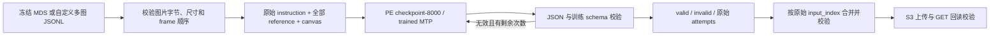

# 多图 PE 推理：e6d88249d08d / checkpoint-8000

将**原始 instruction + 有序 reference images + 目标画布尺寸**输入 PE，得到包含 `reference_edits` 的 JSON caption。

- [训练 run](https://forge.coreweave.com/wandb/canva-core-cn/design-layout-megatron-swift/runs/e6d88249d08d)：固定 checkpoint-8000，不读取 latest。
- 支持 **1–12 张 reference**，顺序固定为 `frame_0`、`frame_1`……；原指令中的 image 1 对应 `frame_0`。
- 使用训练时的 source-only PE prompt 和 non-thinking assistant prefix。训练 prompt 会按原协议对 instruction 做 `.strip()` 和 JSON escaping；输入记录保留用户原文。
- 输出 bbox 为 `xyxy_1000`，不是 native reader 的 yxyx。
- 所有模型来源是 S3；模型在当前 work 目录生成下载缓存，不依赖历史 devbox 路径。



## 模型与固定协议

唯一来源表是 [model.lock.json](model.lock.json)。

```text
# 原始 MCore checkpoint（lineage；正常推理无需重新转换）
s3://core-cn-oss.canva.com/usr/grantzhang/design-layout-megatron-swift/runs/multiref-pe-c17k-b300128/20261007-e6d88249d08d/mcore/checkpoint-8000/

# 已完成并验证的 trained HF export（推理实际下载来源）
s3://core-cn-oss.canva.com/usr/grantzhang/multireference-pe/evaluations/e6d88249d08d-c8000-ocr-eval-h10064-20261007/model/hf/
```

| 身份 | 固定值 |
|---|---|
| MCore manifest SHA256 | `c6d244705f98b7d6735d324c72583df998428db1230e60756e1cf95d95933a89` |
| trained HF manifest SHA256 | `b0984d2ecaf3a51881f112f1f4530602ff72a4cfbca32a93cff7b1b1de42a943` |
| prompt contract SHA256 | `b130b8a18049dd80e5a6367c4eb453bf5b5f6604a437a18bd248210ceed48131` |
| tensor / MTP tensor | 738 / 15；15 个 MTP tensor 均经过训练 |
| FP32 状态保留 | 48 个 `A_log` / `dt_bias` 参数 |

`stage-model` 先检查 S3 `_SUCCESS`、manifest 和 lineage，再逐文件校验 bytes/SHA256。initializer 是来源追溯信息，不能直接替代 trained HF 权重。

| 推理参数 | 值 |
|---|---|
| 环境 | Python 3.12、torch 2.11.0、vLLM 0.26.0、transformers 5.8.0，使用冻结环境归档 |
| dtype / tensor parallel | BF16 / 1 |
| trained MTP | 1 speculative token |
| attention / execution | FLASHINFER / eager |
| max model len / max new tokens | 32768 / 27000 |
| max pixels | 2359296，由模型 processor 处理 |
| max num seqs / batched tokens | 4 / 32768 |
| GPU memory utilization | 0.82 |
| 默认 bounded temperature | `[0.0, 0.2, 0.6, 0.6, 0.8, 1.0]` |
| top_p / top_k | 首轮 1.0，后续 0.95 / -1 |
| seed，attempt 0–2 | `42 + input_index + attempt * 10000` |
| seed，attempt 3–5 | `100042 + input_index + (attempt - 3) * 10000` |

默认重试依据仅为 JSON/schema 校验，不按视觉质量选择。`--sampling greedy` 只执行首轮，不自动补采样。达到长度上限的输出按无效处理。所有失败和 attempts 保留；本 pipeline 不自动执行历史人工结构修复。

## 运行条件与环境恢复

运行于已分配给自己的 Linux x86_64 H100 GPU 环境。命令仅启动本任务的推理进程，不申请、接管或释放 UTP 作业。UTP 使用授权的工作负载身份及团队 Arnold 流程；`--profile` 可显式指定 AWS profile，不传时使用标准工作负载 credential chain。

下面所有命令从仓库根目录执行。设置新的、位于源码目录之外的 work 目录；替换 S3 示例中的 `YOUR_NAME` 和 `YOUR_UNIQUE_RUN`。不同节点可使用不同 work 路径，但输入快照、world size、采样模式和输出前缀必须相同。

```bash
export MREF_WORK=/mnt/ephemeral/mref-e6d8-c8000-my-run
export MREF_OUT=s3://core-cn-oss.canva.com/usr/YOUR_NAME/multireference-pe/evaluations/YOUR_UNIQUE_RUN
export AWS_PROFILE=core-cn-s3-readwrite

# 复用本仓库冻结的 caption 环境恢复器；归档 SHA 与多图历史运行一致。
python3 package/restore_caption_env.py --assets "$MREF_WORK/assets" --profile "$AWS_PROFILE"
export MREF_PY="$MREF_WORK/assets/env/caption/bin/python"

python3 multi_reference/pipeline.py stage-model \
  --work-root "$MREF_WORK" --profile "$AWS_PROFILE"
```

Bootstrap Python 需要 `boto3`；准备输入和 CPU 测试需要 Pillow。模型推理使用恢复后的 `MREF_PY`。已完成恢复的环境可直接复用；恢复脚本会拒绝覆盖已有环境目录。模型恢复会验证已缓存文件并补下载缺失/损坏文件。

## 输入方式一：冻结 419 条多图评测

```bash
python3 multi_reference/pipeline.py prepare \
  --work-root "$MREF_WORK" --output-s3 "$MREF_OUT" \
  --world-size 1 --sampling bounded --profile "$AWS_PROFILE"
```

数据来自：

```text
s3://core-cn-oss.canva.com/usr/josephbai/editing-ocr-repair/full-1k-20260929-v1/region-bound-v5-20260930/delivery-v2/mds/eval/multireference-pkl-v2/
```

恢复器校验冻结 index 和 6 个 MDS shard 的 SHA256，提取原始 `instructions[0]`、全部有序 embedded reference bytes，并核对每张图片尺寸。它读取 target 图仅用于核对画布尺寸；目标图像素、详细指令、旧 caption/annotation 均不进入 `inputs.jsonl` 或 PE 请求。MDS 归档本身包含评测原始数据，保存在独立的 `mds/` 下载目录。

MDS 模式的 reference SHA 对应 **embedded 图片字节**；其中 `source_uri` 是原始来源记录。原始 S3 文件可能与 embedded 图片字节不同，因此复现历史评测必须使用本模式，不能把其 SHA 直接用于下载原始 S3 图片的自定义模式。

## 输入方式二：自定义多图 JSONL

每行必须有 `input_index`、`sample_id`、`instruction`、`reference_images`、`target_canvas_size`。reference 必须按用户图像顺序排列，并提供 S3 URI、原始文件 SHA256、原始宽高；可选 `role` 和 `bytes`。示意：

```json
{
  "input_index": 0,
  "sample_id": "my-case-0",
  "instruction": "Use the subject in image 1 and the background in image 2.",
  "reference_images": [
    {"reference_id": "frame_0", "source_uri": "s3://your-bucket/ref1.png", "sha256": "REPLACE_WITH_64_HEX_SHA256", "width": 1024, "height": 1024},
    {"reference_id": "frame_1", "source_uri": "s3://your-bucket/ref2.png", "sha256": "REPLACE_WITH_64_HEX_SHA256", "width": 1536, "height": 1024}
  ],
  "target_canvas_size": {"width": 1024, "height": 1024}
}
```

实际文件每个对象占一行；可参考 [two-references.jsonl](examples/two-references.jsonl)，它使用历史数据中两个原始 S3 reference，并独立回读校验了原始 S3 文件的 SHA/尺寸。这个示例作为自定义输入，不冒充 MDS embedded 字节的历史复现。用户无需提供 target 图，只需给出目标画布尺寸。

```bash
python3 multi_reference/pipeline.py prepare \
  --work-root "$MREF_WORK" --output-s3 "$MREF_OUT" \
  --input-jsonl /path/to/my-inputs.jsonl \
  --world-size 1 --sampling bounded --profile "$AWS_PROFILE"
```

输入记录不能包含 target pixels、target URI、已有 caption 或 detailed instruction。`frame_N` 重排、重复样本、空指令、错误 SHA/尺寸会报错。图片在送入模型 processor 前只解码为 RGB，不 resize/re-encode。

## 单 GPU 推理、合并、发布

先用独立 work 和输出前缀对少量自定义输入做 canary，再准备正式运行。检查有效性、reference grounding、bbox 和原始 response；schema 合法性不等于语义质量。

```bash
CUDA_VISIBLE_DEVICES=0 "$MREF_PY" multi_reference/pipeline.py infer \
  --work-root "$MREF_WORK" --rank 0

python3 multi_reference/pipeline.py aggregate --work-root "$MREF_WORK"
python3 multi_reference/pipeline.py publish --work-root "$MREF_WORK" --profile "$AWS_PROFILE"
```

`infer` 默认输出到本地；`publish` 完成 S3 GET 回读校验后写入 `VERIFIED.json`。存在同名且内容不同的 S3 对象时拒绝覆盖。

## 多 GPU / 多节点

例如 8 节点 × 每节点 8 张 GPU：各节点恢复环境、模型并执行相同的 `prepare --world-size 64`。不要在已开始推理的目录重新 prepare 或切换采样模式。

```bash
# 每个节点都执行；node-index 分别取 0–7。
"$MREF_PY" multi_reference/pipeline.py run-node \
  --work-root "$MREF_WORK" --node-index 0 --gpus-per-node 8 \
  --publish --profile "$AWS_PROFILE"

# 所有节点完成后，在一个已 prepare 的节点收集并发布。
python3 multi_reference/pipeline.py aggregate \
  --work-root "$MREF_WORK" --from-s3 --profile "$AWS_PROFILE"
python3 multi_reference/pipeline.py publish \
  --work-root "$MREF_WORK" --profile "$AWS_PROFILE"
```

只分片一次：`input_index % world_size == rank`。`world_size=8` 可用于一个 8-GPU 节点；每卡一个独立 vLLM engine。launcher 遵守已设置的 `CUDA_VISIBLE_DEVICES` 顺序，单卡出错会终止本次 launcher 的其他子进程。它不访问 Kubernetes，也不启动或释放 hold JobSet。

每个 rank 有独立 writer lock、cache、短 TMPDIR、输出和 log。续跑相同命令时验证 run/input/model/prompt 身份，已成功样本不再生成；未完成样本继续剩余的重试次数。完成后仍无效的样本保留在 invalid 中。world size、代码、模型锁或输入变化必须使用新 run。

## 输出契约

| 本地路径 | 内容 |
|---|---|
| `run.json`、`inputs.jsonl` | 冻结配置、portable inputs，均无旧机器路径 |
| `ranks/rank-NNNN/attempts.jsonl` | 每次原始 response、采样参数和失败原因 |
| `ranks/rank-NNNN/predictions.jsonl` | 每个样本选中的输出 |
| `delivery/predictions.jsonl` | 所有选中输出，含无效项 |
| `delivery/valid-predictions.jsonl` | 通过完整 schema 的输出 |
| `delivery/invalid-predictions.jsonl` | 无效输出与原因 |
| `delivery/COMPLETE.json` | counts、模型/prompt/input/输出 SHA |
| `delivery/VERIFIED.json` | S3 发布回读证据 |

输出 caption 根字段顺序为 `normalized_edit_instruction` → `high_level_description` → `style_description` → `elements`。`elements` 包含 `background`、`layout`、`reference_edits`。不得排序 layout、reference groups 或 edit/remove 列表。

`reference_edits` 通过 `frame_N` 指向对应输入图；每个 layout region 恰好有一个 edit，group 内保持 region 顺序，`keep` 必须带 reference_bbox。目标 bbox 以目标画布为基准；reference_bbox 以所属 reference 为基准。发布前重新解析原始 response、校验完整输入身份、每个 rank 的覆盖与 SHA；合并不静默丢弃无效行。

## 历史结果与 DiT 对接

以下是已完成历史实验，不能视为此次重新执行 GPU 推理的结果：

| 阶段 | 有效 / 总量 | 说明 |
|---|---|---|
| 原始 bounded PE 推理 | 417 / 419 | 所有 419 条 JSON 可解析，2 条 schema 无效 |
| targeted recovery | 418 / 419 | index 191 恢复成功，413 仍无效 |
| schema-repaired-v1 | 419 / 419 | index 413 另有明确记录的结构修复，不是纯模型输出 |
| 后续 DiT44k | 419 张 | 401 条直接 caption，18 条还经过 caption compact/recovery |

历史 PE 结果根目录：

```text
s3://core-cn-oss.canva.com/usr/grantzhang/multireference-pe/evaluations/e6d88249d08d-c8000-ocr-eval-h10064-20261007/
```

分别读取 `caption/predictions.jsonl`、`caption/recovery-v1/`、`caption/schema-repaired-v1/`。相应计数和 SHA 回执保存在本目录 [evidence/](evidence/)。

本新增入口止于多图 PE JSON caption。多图 DiT 使用独立的 multi-reference adapter/native reader：保留 frame 绑定，将 target bbox 和 reference_bbox 从 xyxy 转为 yxyx，经过 native admission 后再 encode/infer；仓库原有单图 PE29 的输入校验入口不能接收这个多图格式。

历史多图 DiT 的完成记录和结果位于：

```text
s3://core-cn-oss.canva.com/usr/grantzhang/multireference-pe/evaluations/e6d88249d08d-c8000-dit44k-edit-h10064-20261007/
```

## 本次验证

```bash
python3 -m unittest discover -s multi_reference/tests -v
```

测试使用 Pillow，不需要 GPU、vLLM 或 S3。覆盖全量 419 条输入、全部 419 个历史原始 response、真实 schema 的 417/419 计数、64 分片合并、reference 顺序/像素、target 泄漏拒绝、S3 来源与图片 SHA、空分片、mock engine 重试及续跑。mock 测试不证明 GPU runtime 可用。

另外实际回读验证了 S3 HF manifest 与历史完整预测文件，并执行冻结 MDS 的 CPU 数据准备。验收细节见 [VALIDATION.json](VALIDATION.json)。本次未重新下载完整模型、恢复完整环境或运行 GPU 推理；新硬件运行必须先完成 canary。
